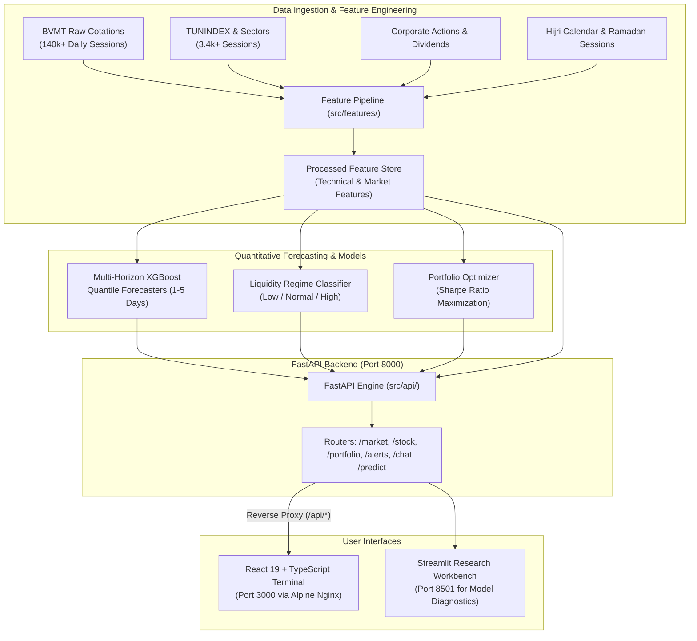

# BVMT Trading Assistant 🇹🇳

[](https://fastapi.tiangolo.com)
[](https://react.dev)
[](https://www.typescriptlang.org)
[](https://xgboost.readthedocs.io)
[](https://www.docker.com)
[](tests/)
[](LICENSE)

An institutional-grade quantitative forecasting and trading intelligence platform designed specifically for the **Bourse des Valeurs Mobilières de Tunis (BVMT)**.

The platform blends probabilistic multi-horizon machine learning, volume liquidity classification, automated portfolio optimization, and a high-performance **React + TypeScript** terminal alongside a **Streamlit** quantitative research workbench.

---

## System Architecture



---

## Core Capabilities

### 📊 Market Intelligence & Overview
- **Real-Time Index Breadth**: Tracks TUNINDEX valuation, daily percentage variation, and historical performance.
- **Top Gainers & Losers**: Continuous sorting of active trading symbols based on closing vs. opening price moves.
- **Market Sentiment Score**: Automated sentiment index (0 to 1) computed from advancing vs. declining equities across the session.

### 🎯 Multi-Horizon Probabilistic Forecasting
- **Quantile Regression Horizons**: Predicts cumulative log-returns $\ln(P_{t+h}/P_t)$ for $h \in \{1, 2, 3, 4, 5\}$ trading days.
- **Confidence Bands**: Generates asymmetric 80% and 95% confidence intervals ($\alpha \in \{0.025, 0.1, 0.5, 0.9, 0.975\}$) to quantify tail risk and volatility.
- **Technical Signals**: Calculates 14-period RSI, MACD convergence/divergence, and provides actionable recommendation ratings (`ACHETER`, `VENDRE`, `CONSERVER`).

### 💼 Portfolio Management & Optimization
- **Dynamic Asset Allocation**: Computes portfolio valuations, ROI, sector allocations, and individual position P&L in Tunisian Dinars (TND).
- **Quant Rebalancing Suggestions**: Identifies over-weight sector concentrations and suggests profit-taking or risk-hedging actions.

### 🚨 Market Surveillance & Automated Alerts
- **Volume Spike Detection**: Flags abnormal liquidity bursts (> 1.5× 30-day moving average).
- **Price Breakout Alerts**: Monitors technical support and resistance crossings in real-time.
- **Severity Triage**: Classifies alerts into `High`, `Medium`, and `Low` urgency tiers.

### 🤖 Intelligent Market Copilot
- **Interactive Chat Assistant**: Dedicated assistant answering queries about individual BVMT equities, market conditions, and quantitative indicators in French.

---

## Quick Start (Docker Compose)

The entire ecosystem (FastAPI backend, React frontend, and Streamlit workbench) orchestrates via a single command:

```bash
# 1. Clone the repository
git clone https://github.com/anwrG-p/BVMT-Trading-Assistant.git
cd BVMT-Trading-Assistant

# 2. Launch all services
docker-compose up -d --build
```

### Active Service Endpoints

| Service | Port | Description | URL |
| :--- | :--- | :--- | :--- |
| **React Trading Dashboard** | `3000` | Primary production interface (TypeScript + Nginx) | [http://localhost:3000](http://localhost:3000) |
| **FastAPI REST Engine** | `8000` | Interactive OpenAPI / Swagger Documentation | [http://localhost:8000/docs](http://localhost:8000/docs) |
| **Streamlit Workbench** | `8501` | Quant research, model diagnostics & backtests | [http://localhost:8501](http://localhost:8501) |

---

## Quantitative Engine & Methodology

### 1. Multi-Horizon Quantile Regression
Rather than simple point estimates, the pricing engine fits multiple gradient-boosted decision trees using the **Pinball Loss** function:

$$L_\alpha(y, \hat{y}) = \max(\alpha (y - \hat{y}), (\alpha - 1)(y - \hat{y}))$$

Trained for quantiles $\alpha \in \{0.025, 0.1, 0.5, 0.9, 0.975\}$, yielding empirical predictive distributions:
- **Median ($\alpha = 0.50$)**: Central price path expectation.
- **80% Confidence Interval**: $[\hat{y}_{0.10}, \hat{y}_{0.90}]$
- **95% Confidence Interval**: $[\hat{y}_{0.025}, \hat{y}_{0.975}]$

### 2. Feature Pipeline
- **Price Action**: Log returns, rolling volatility, High-Low spreads, ATR.
- **Technical Indicators**: Relative Strength Index (RSI 14), Moving Average Convergence Divergence (MACD 12/26/9), Bollinger Bands.
- **Market Context**: Sector relative returns, TUNINDEX correlation.
- **Calendar & Cultural Adjustments**: Hijri calendar converter for Islamic holidays and truncated Ramadan trading hours.

### 3. Walk-Forward Validation
Models are evaluated using strict out-of-time walk-forward expanding window cross-validation across unique BVMT trading calendar days to prevent lookahead bias.

---

## API Reference

The FastAPI service exposes RESTful endpoints supporting both the modern React interface and third-party algorithmic integrations:

| Method | Endpoint | Description |
| :--- | :--- | :--- |
| `GET` | `/health` | System health check (data and models status) |
| `GET` | `/symbols` | List all available BVMT stock symbols |
| `GET` | `/market/overview` | Tunindex performance, top gainers, losers, sentiment |
| `GET` | `/stock/{symbol}` | 60-day historical prices, 5-day forecasts, RSI & MACD |
| `GET` | `/portfolio` | Capital valuation, positions, allocations, suggestions |
| `GET` | `/alerts` | Real-time volatility and volume anomaly notifications |
| `POST` | `/chat` | Natural language market assistant query |
| `POST` | `/predict` | On-demand multi-horizon quantile prediction |
| `POST` | `/predict/realtime`| Prediction with dynamic data refresh |
| `GET` | `/visualization/{symbol}` | Charting data with confidence bounds |

Full schemas and example payloads are detailed in [**`docs/API_DOCUMENTATION.md`**](docs/API_DOCUMENTATION.md).

---

## Documentation Hub

Comprehensive architectural, mathematical, and operational documentation is organized in [`docs/`](docs/):

| Document | Focus Area |
| :--- | :--- |
| [**Architecture Guide**](docs/ARCHITECTURE.md) | In-depth system design, component boundaries, and data flow |
| [**API Documentation**](docs/API_DOCUMENTATION.md) | Exhaustive REST endpoint contracts, schemas, and status codes |
| [**Model Card**](docs/MODEL_CARD.md) | XGBoost specifications, loss functions, and evaluation metrics |
| [**Data Schema**](docs/DATA_SCHEMA.md) | Raw data formats, parquet storage layout, and feature catalog |
| [**Developer Guide**](docs/DEVELOPER_GUIDE.md) | Local environment setup, test workflows, and coding standards |
| [**Deployment Guide**](docs/DEPLOYMENT_GUIDE.md) | Production Docker configuration, Nginx setup, and scaling |
| [**User Guide**](docs/USER_GUIDE.md) | Trader manual for dashboard navigation and signal interpretation |
| [**Contributing Guide**](docs/CONTRIBUTING.md) | Git branch conventions, PR process, and code quality rules |
| [**Changelog**](docs/CHANGELOG.md) | Historical release notes and version progression |
| [**Agent Guidelines**](AGENTS.md) | Guidelines for autonomous coding agents operating on this repo |

---

## Local Development (Without Docker)

### Backend (Python 3.10+)

```bash
# 1. Create and activate a virtual environment
python -m venv .venv
source .venv/bin/activate  # Windows: .venv\Scripts\activate

# 2. Install dependencies
pip install -e .

# 3. Start the FastAPI development server
uvicorn src.api.main:app --host 0.0.0.0 --port 8000 --reload

# 4. Run test suite
pytest tests/
```

### Frontend (Node 20+)

```bash
# 1. Navigate to the frontend directory
cd dashboard-frontend

# 2. Install dependencies
npm install

# 3. Start the Vite development server
npm run dev

# 4. Verify TypeScript build
npm run build
```

---

## Technology Stack

- **Backend**: Python 3.10+, FastAPI, Pydantic, Pandas, NumPy, XGBoost, Uvicorn
- **Frontend**: React 19, TypeScript 5, Vite 7, Recharts, Lucide Icons, Tailwind CSS
- **Analytics UI**: Streamlit, Plotly
- **Infrastructure**: Docker, Docker Compose, Alpine Nginx
- **Testing & Quality**: Pytest, TypeScript Compiler (`tsc`), ESLint

---

## License

This project is licensed under the MIT License — see the [LICENSE](LICENSE) file for details.
